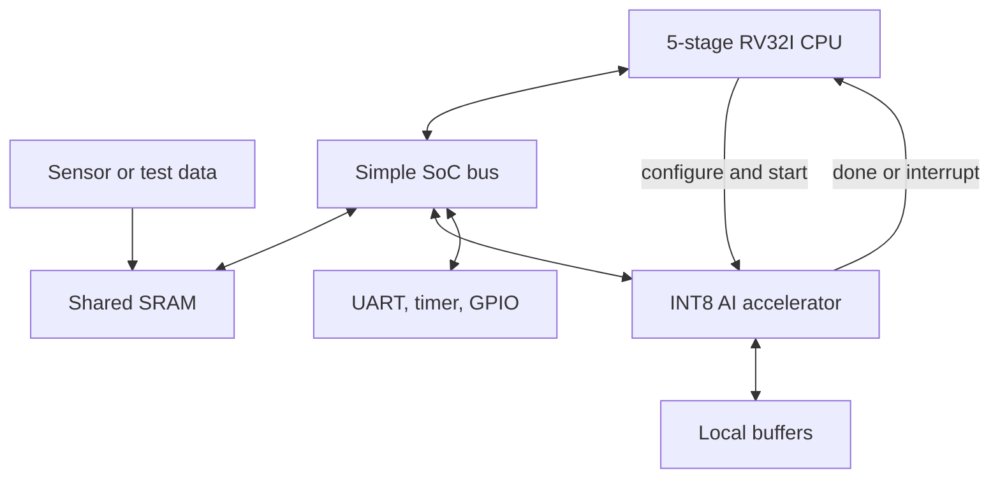

# RVA1: Two-Person RISC-V + AI Accelerator Workflow

## 1. Project Vision

Build a small edge-AI system-on-chip (SoC) containing:

- A five-stage `RV32I` RISC-V processor
- A memory-mapped `INT8` neural-network accelerator
- Shared/local SRAM and basic peripherals
- Software that configures the accelerator and runs inference
- An FPGA demonstration
- Optional ASIC synthesis and physical design

The recommended demonstration is a small classifier that accepts camera, audio, or motion-sensor data and produces a class prediction locally. The initial hardware target should be modest: a `4x4` or `8x8` MAC array running a quantized MLP, tiny CNN, or keyword-spotting model.

### Success statement

> Our custom RV32I SoC executes embedded software that sends quantized inference work to an INT8 accelerator, receives a correct classification result, and demonstrates measurable speedup over CPU-only execution.

## 2. Scope Boundaries

### Minimum viable product (MVP)

- RV32I processor executes a test program from instruction memory
- Five-stage pipeline supports forwarding, stalls, branches, and flushes
- Memory-mapped accelerator registers are accessible with normal `lw`/`sw`
- Accelerator correctly computes a tiled INT8 matrix multiplication
- Software starts the accelerator, waits for completion, and reads results
- RTL results match a Python golden model
- Full system runs on an FPGA or in a cycle-accurate simulation

### Target product

- `4x4` or `8x8` INT8 MAC array
- Local accelerator buffers
- Bias addition, ReLU, and requantization
- Interrupt or status-based completion
- One complete quantized model running end to end
- UART output showing class, score, cycle count, and CPU-versus-accelerator timing

### Stretch goals

- DMA or bus-master data transfer
- Double buffering
- Convolution lowering or direct convolution support
- FPGA camera/audio/IMU input
- ASIC synthesis, static timing analysis, place-and-route, and power estimation
- Fabrication only if an accessible shuttle program and verified memory macros are available

### Explicitly out of scope for version 1

- Linux
- Virtual memory
- Caches or cache coherence
- Floating-point arithmetic
- AXI unless required by the FPGA platform
- A general-purpose GPU/NPU instruction set
- Large models or transformer/LLM inference

## 3. High-Level Architecture



### Suggested memory map

| Address range | Block | Notes |
|---|---|---|
| `0x0000_0000–0x0000_FFFF` | Instruction memory | Program and constants |
| `0x1000_0000–0x1000_FFFF` | Data SRAM | Inputs, weights, outputs, stack |
| `0x4000_0000–0x4000_00FF` | AI control registers | Configuration and status |
| `0x4000_1000–0x4000_10FF` | UART | Debug and results |
| `0x4000_2000–0x4000_20FF` | Timer/GPIO | Timing and visible demo |

### Initial accelerator registers

| Offset | Register | Function |
|---:|---|---|
| `0x00` | `CONTROL` | Bit 0: start; bit 1: clear/error reset |
| `0x04` | `STATUS` | Busy, done, and error bits |
| `0x08` | `INPUT_ADDR` | Input matrix/tensor base address |
| `0x0C` | `WEIGHT_ADDR` | Weight base address |
| `0x10` | `BIAS_ADDR` | Bias base address |
| `0x14` | `OUTPUT_ADDR` | Output base address |
| `0x18` | `DIM_M` | Output rows |
| `0x1C` | `DIM_N` | Output columns |
| `0x20` | `DIM_K` | Reduction dimension |
| `0x24` | `QUANT_CONFIG` | Shift, scale, clamp/ReLU settings |
| `0x28` | `CYCLE_COUNT` | Accelerator execution cycles |

Freeze this register contract before either subsystem depends on it. Add registers later without changing the meaning of existing addresses.

## 4. Team Ownership

### Person A — CPU, SoC, and firmware owner

- RV32I ISA subset and five-stage pipeline
- Decode, ALU, register file, forwarding, stalls, branches, and flushes
- Instruction/data memory interfaces
- SoC address decoder and peripheral bus
- UART, timer, and GPIO
- Bare-metal startup code, linker script, drivers, and test application
- CPU compliance and firmware tests

### Person B — accelerator and model owner

- Model selection, training or fine-tuning, and INT8 quantization
- Python/Numpy golden reference
- Processing element and MAC-array RTL
- Accelerator controller, tiling, address generation, and local buffers
- Bias, activation, and requantization units
- Accelerator unit tests and performance counters
- Export of weights, biases, inputs, and expected outputs

### Shared ownership

- Architecture and interface specifications
- Memory bandwidth and SRAM sizing
- Integration testbench
- FPGA pinout, constraints, build, and board bring-up
- Performance/area/power measurements
- Documentation, final demo, and presentation

Ownership means the named person reviews and accepts changes to that block. It does not mean the other person is prohibited from contributing.

## 5. Contract-First Parallel Development

Before substantial RTL work, agree on these contracts:

1. Clock, reset polarity, reset behavior, and maximum target frequency
2. Bus signals and transaction timing
3. Memory map and accelerator register definitions
4. Memory layout for tensors and weights
5. Signed INT8 arithmetic, accumulator width, overflow behavior, rounding, and saturation
6. Start/busy/done/error sequencing
7. Interrupt behavior, if used
8. Test-vector file format and byte order
9. Required supported tensor/matrix dimensions
10. Definition of a correct end-to-end inference

Each side initially integrates against a mock:

- Person A uses a dummy accelerator that becomes busy, waits a fixed number of cycles, then returns a known result.
- Person B uses a bus-functional CPU model or testbench that writes configuration registers and supplies memory responses.

This prevents either person from waiting for the other's full subsystem.

## 6. Twelve-Week Concurrent Schedule

| Week | Person A: CPU/SoC/Firmware | Person B: AI/Accelerator | Joint integration gate |
|---:|---|---|---|
| 1 | Define RV32I subset, CPU interfaces, toolchain, and basic testbench | Select use case/model; establish accuracy baseline; define quantization | Freeze MVP, clock/reset, bus, register map, tensor layout, and acceptance metrics |
| 2 | Implement register file, ALU, immediate generation, decode | Build Python integer golden model; export deterministic test vectors | Both mocks can perform the agreed register and memory transactions |
| 3 | Implement fetch/decode/execute pipeline and basic arithmetic instructions | Implement signed INT8 MAC/PE and accumulator; unit-test edge cases | Golden arithmetic rules match RTL exactly |
| 4 | Add memory/writeback stages, loads/stores, and branches | Build `4x4` array and controller; support one matrix tile | CPU runs directed assembly; accelerator passes one-tile tests |
| 5 | Add forwarding, load-use stalls, branch flushes, and pipeline assertions | Add local buffers, address generation, and multi-tile operation | First subsystem regressions are automated and green |
| 6 | Complete required RV32I instructions; add SoC bus and address decode | Implement memory-mapped register interface and busy/done/error behavior | CPU communicates with dummy accelerator; real accelerator works with bus model |
| 7 | Add UART/timer and bare-metal accelerator driver | Add bias, ReLU, requantization, and cycle counter | **Integration 1:** CPU starts real accelerator and receives a correct small result |
| 8 | Improve firmware, linker/memory layout, and exception-safe polling | Map first neural-network layer; verify exported weights and tensors | Layer output matches the Python model exactly or within defined quantization tolerance |
| 9 | Run CPU-only reference or software fallback; add timing code | Execute all supported model layers and finalize scheduling | **Integration 2:** end-to-end inference passes in RTL simulation |
| 10 | Prepare FPGA top level, memories, UART program loading, and constraints | Optimize timing/utilization; pipeline critical paths if required | FPGA bitstream builds; memory initialization and I/O paths are verified |
| 11 | FPGA bring-up, software debugging, result display | FPGA accelerator debugging and performance counters | **Integration 3:** live or stored-input FPGA demo gives correct prediction |
| 12 | Final regression, documentation, and CPU performance results | Final accuracy, throughput, resource, and accelerator performance results | Demo freeze, tagged release, reproducible build, report, and presentation |

### Optional weeks 13–16: ASIC path

| Week | Main work | Exit criterion |
|---:|---|---|
| 13 | ASIC-compatible cleanup, lint, clock/reset audit, SRAM strategy | Synthesizable design with no FPGA-only logic in the ASIC core |
| 14 | Logic synthesis, timing constraints, area/timing optimization | Clean synthesis and understood timing paths |
| 15 | Floorplan, power grid, placement, clock tree, routing | Routed design with acceptable congestion and timing |
| 16 | DRC/LVS, gate-level simulation, power estimate, final GDS/report | Reproducible physical-design results; tapeout only if signoff requirements are met |

## 7. Weekly Operating Rhythm

### Monday — plan and interfaces

- Review last week's regression and unresolved bugs
- Select no more than two major deliverables per person
- Record any interface change as a reviewed specification change

### Tuesday–Thursday — independent implementation

- Work primarily within owned modules
- Add tests with every feature
- Merge small, passing changes rather than one large weekly branch
- Use mocks whenever the other subsystem is unavailable

### Friday — integration and measurement

- Run CPU, accelerator, and full-system regressions
- Integrate only versions that pass subsystem tests
- Record correctness, cycle count, FPGA utilization/timing, and open defects
- Demonstrate one observable improvement each week

### Weekend or final work session — stabilize

- Fix integration regressions
- Update the architecture log and next-week risks
- Avoid starting unplanned features while a broken main branch exists

## 8. Repository and Branch Workflow

```text
rtl/
  cpu/
  accelerator/
  soc/
  peripherals/
tb/
  cpu/
  accelerator/
  integration/
sw/
  firmware/
  drivers/
  linker/
model/
  training/
  quantization/
  golden/
  test_vectors/
fpga/
asic/
docs/
scripts/
```

- Protect `main`: it must always build and pass the agreed smoke tests.
- Use short feature branches such as `cpu/load-use-stall` or `accel/requantize`.
- Require one teammate review for changes to shared interfaces or top-level integration.
- Keep generated binaries, waveforms, and tool databases out of version control unless intentionally released.
- Tag stable milestones: `m1-cpu-smoke`, `m2-accel-matmul`, `m3-soc-sim`, `m4-fpga-demo`.
- Record important choices in short architecture decision records under `docs/decisions/`.

## 9. Verification Strategy

### CPU verification

- Directed assembly tests for each instruction
- Hazard tests for forwarding, load-use stalls, branch flushes, and back-to-back dependencies
- Misaligned/unsupported access behavior defined and tested
- RV32I compliance tests where compatible with the implementation
- Assertions for illegal simultaneous controls and pipeline invariants

### Accelerator verification

- Compare every RTL output against the integer golden model
- Test zeros, ones, negative values, maximum/minimum INT8, overflow, saturation, and rounding boundaries
- Test odd dimensions that do not fill the array
- Test one tile, multiple tiles, and repeated invocations
- Test illegal configuration, start-while-busy, reset-while-busy, and memory latency

### Full-system verification

- Firmware writes and reads every accelerator register
- CPU launches a deterministic matrix multiplication and checks every output
- Model-layer outputs are checked at intermediate boundaries
- End-to-end class scores match the quantized Python reference
- UART/result protocol is deterministic and machine-readable
- Reset and repeated inference work without reprogramming the FPGA

### Regression tiers

| Tier | Trigger | Contents | Target duration |
|---|---|---|---:|
| Smoke | Every commit | Compile/lint plus a few CPU and accelerator tests | Under 5 minutes |
| Subsystem | Every merge request | Complete CPU or accelerator suite | Under 20 minutes |
| Integration | Nightly or before merge to main | Firmware boot, accelerator transaction, small inference | Under 45 minutes |
| Release | Weekly/milestone | All tests, FPGA build, timing/utilization reports | As needed |

## 10. Definition of Done

### A module is done when

- Its behavior and interface are documented
- It passes nominal and edge-case tests
- It has no unexplained lint errors or warnings
- Reset behavior is verified
- The teammate can reproduce its tests from a clean checkout

### The project MVP is done when

- The CPU boots the final firmware
- The CPU configures the real accelerator through the documented register map
- The accelerator reads operands, computes, and writes results correctly
- Results match the Python golden model
- The same end-to-end test passes repeatedly
- Cycle count and basic resource/timing results are reported
- The build and demo instructions work from a clean checkout

## 11. Performance and Evaluation Metrics

Track these from the beginning:

- Model accuracy before and after INT8 quantization
- CPU-only inference cycles
- Accelerated inference cycles
- End-to-end speedup, including data transfer
- Accelerator utilization and achieved MACs per cycle
- FPGA LUT, flip-flop, DSP, and BRAM usage
- Maximum achieved clock frequency
- ASIC cell area, timing slack, and estimated power if the ASIC flow is completed

Useful equations:

$$
\text{Speedup} = \frac{\text{CPU-only cycles}}{\text{accelerated end-to-end cycles}}
$$

$$
\text{Array utilization} = \frac{\text{useful MAC operations}}{\text{MAC units} \times \text{accelerator cycles}}
$$

Report both theoretical peak throughput and measured end-to-end throughput. Do not omit memory-transfer and software-control time from the measured result.

## 12. Risk Register and Scope Cuts

| Risk | Early warning | Mitigation | First scope cut |
|---|---|---|---|
| CPU pipeline bugs | Directed tests pass individually but programs fail | Assertions, instruction trace, compare against reference model | Use a known simple core only if custom CPU is not a grading requirement |
| Accelerator memory starvation | MAC array utilization is consistently low | Local buffers, tiling, burst-like sequential accesses | Reduce array from `8x8` to `4x4` |
| Quantized model mismatch | Layer outputs diverge from Python | Freeze exact rounding/saturation rules and inspect each layer | Use an MLP or smaller CNN |
| Integration slips | Both blocks work alone after week 7 but not together | Maintain mocks; enforce week 7 Integration 1 | Poll status instead of interrupts; use stored test data |
| FPGA timing failure | Large negative slack by week 10 | Pipeline long paths and reduce fanout/array size | Lower clock target or array size |
| Camera/audio interface consumes schedule | No stable sensor samples by week 9 | Use preloaded samples first | Keep live sensor input as a stretch goal |
| ASIC tools/memory macros block progress | FPGA-specific blocks remain after week 12 | Separate portable core from platform wrappers | Deliver synthesis/P&R report without tapeout |

When behind schedule, cut features in this order:

1. Live sensor input
2. Interrupts; use polling
3. DMA and double buffering
4. Larger MAC array
5. Multiple model types
6. ASIC physical implementation

Never cut golden-model comparison, subsystem tests, or the basic CPU-to-accelerator integration.

## 13. Demo Sequence

1. Reset the FPGA/SoC.
2. CPU prints its boot message through UART.
3. Firmware identifies the test sample or captures one sensor input.
4. CPU prints the input/model addresses and starts the accelerator.
5. Accelerator computes the required layers and records its cycle count.
6. CPU reads the output, selects the winning class, and prints scores.
7. GPIO/LED or another actuator shows the classification.
8. The demo prints CPU-only and accelerated cycle counts and calculated speedup.

A preloaded test sample is the reliable primary demo. A live camera, microphone, or IMU should be a secondary demo so sensor instability cannot prevent the core SoC demonstration.

## 14. Immediate First-Week Checklist

- [ ] Select the application: image, keyword, vibration, or gesture classification
- [ ] Select FPGA board and confirm available BRAM/DSP blocks and clocking
- [ ] Agree on `RV32I` instruction coverage
- [ ] Choose `4x4` or `8x8` INT8 MAC array
- [ ] Choose initial model and dataset
- [ ] Fix arithmetic rules: signedness, accumulator width, rounding, saturation, ReLU
- [ ] Freeze version 1 bus, register map, and tensor memory layout
- [ ] Create repository structure and automated smoke-test command
- [ ] Build dummy accelerator and bus-functional CPU model
- [ ] Produce the first shared test vector and expected output
- [ ] Schedule the three integration gates in advance

## 15. Decisions Still Needed

The following answers refine the plan without blocking the initial architecture work:

1. What is the final application: smart camera, keyword spotting, industrial anomaly detection, gesture recognition, or something else?
2. Which FPGA board and toolchain are available?
3. How many calendar weeks and hours per person per week are available?
4. Is a custom five-stage CPU required, or may an existing verified RISC-V core be used?
5. Is ASIC place-and-route required, optional, or out of scope?
6. Must the final demo use a live sensor, or is a preloaded test sample acceptable?

Until these are answered, use these defaults: 12 weeks, approximately 8–10 hours per person per week, a custom five-stage RV32I core, an `8x8` INT8 accelerator if FPGA resources permit, preloaded inputs for the primary demo, and ASIC implementation as a stretch goal.
